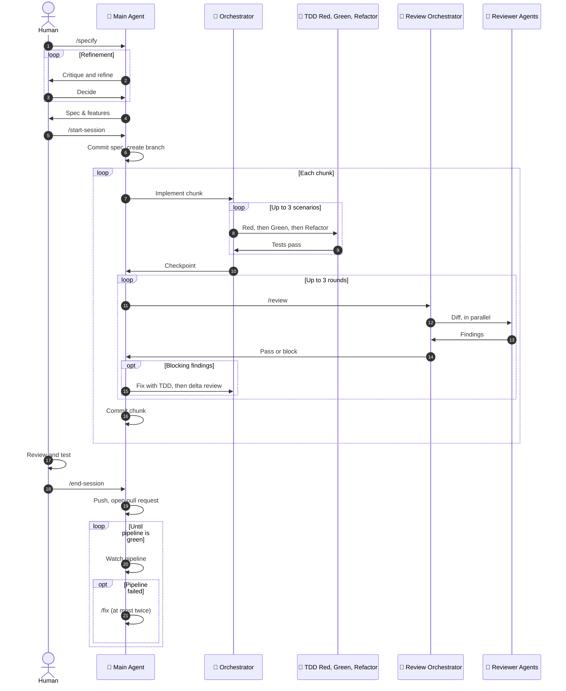

# .agents

A version-controlled home for [Claude Code](https://claude.ai/code) configuration: slash commands, skills, and
plugins. The repo is public because Claude Code installs plugins from a GitHub marketplace, not from a local working copy.

## Installation

Add the marketplace once, then install whichever plugins you need:

```bash
/plugin marketplace add nikoheikkila/.agents
/plugin install alt-text-generator@nikoheikkila-agents
/plugin install tdd@nikoheikkila-agents
```

Installed plugins are pinned to a commit SHA, so a change pushed to this repo isn't picked up automatically. Update
with:

```bash
/plugin marketplace update nikoheikkila-agents
/plugin install <name>@nikoheikkila-agents
```

## Available Plugins

### `alt-text-generator`

Generates screen-reader-compatible alt text for images.

- Skill `generating-alt-text` — invoke directly as `/alt-text-generator:generating-alt-text` for interactive use, or
  let it trigger automatically on prompts like "write alt text for this image" or "is this accessible for screen
  readers?"
- Agent `alt-text-generator` — a noninteractive subagent (no clarifying questions, no preamble) that reads an image
  and returns alt text, intended for use by other agents or automation rather than direct chat.

### `tdd`

Skills for the Red-Green-Refactor test-driven development cycle:

- `red` — write a failing test first, driven from Gherkin/BDD feature files, before any implementation exists.
- `green` — implement the minimal code needed to make a failing test pass, without over-engineering.
- `refactor` — improve code quality and design once tests are green, without changing behaviour.

Invoke as `/tdd:red`, `/tdd:green`, `/tdd:refactor`, or let them trigger on natural mentions of starting a TDD cycle,
making a test pass, or cleaning up passing code.

## Commands

`commands/reflect.md` → `/reflect` — a post-session maintenance loop. It reviews the current session for friction and
writes durable improvements back into the relevant repo: repo-wide instructions into `AGENTS.md`/`CLAUDE.md`,
human-facing docs into `README.md`, and skill amendments under `.claude/skills/` (or, when run inside this repo,
under this repo's own `skills/`/`plugins/`).

The review gate is the skill `skills/review` (invoked as `/review`); see [How the gate converges](#how-the-gate-converges).
The three commands here drive the agentic-CD pipeline in `agents/`, starting from a spec written with the `specify`
skill:

- `commands/start-session.md` → `/start-session <spec | #issue | bug>` — commits the spec, creates the feature
  branch, and loops: the `orchestrator` runs up to three `tdd-red` → `tdd-green` → `tdd-refactor` cycles, `/review`
  gates the chunk, and the chunk is committed. A bug report without a spec goes through `specify`'s bugfix mode
  first.
- `commands/end-session.md` → `/end-session` — checks that everything is committed and the base pipeline is green,
  pushes, opens the pull request with deferred findings and accepted risks from the ledger, and watches the run.
- `commands/fix.md` → `/fix [run URL | run id | failing command]` — reads the failed CI log, classifies the failure, routes
  code and config failures to the `orchestrator`, reruns flakes once, and reviews, commits, and pushes the fix.

`/start-session` and `/end-session` carry `disable-model-invocation: true` — type those yourself. `/review` and `/fix`
stay model-invocable, because `/start-session` runs `/review` for every chunk and a red pipeline should pull in `/fix`
without being asked. Session state survives `/clear` in a ledger under the git directory
(`skills/review/scripts/ledger.sh`).

## Agentic CD Workflow

The commands, skills, and subagents below form one loop. Humans own the start (the spec) and the end (acceptance and
push); agents own everything between, one small chunk at a time.



1. **Specify.** The human runs `/specify` to create and refine the spec artifacts: the intent, the BDD scenarios, the
   feature description, and the acceptance criteria.
2. **Start the session.** The human runs `/start-session` to start working on a scenario. The main agent commits the
   spec, creates the branch, and begins the chunk loop.
3. **Gather context.** The main agent invokes `orchestrator`, which assembles the minimum context for the chunk: the
   feature description, the scenarios still to do, the files they touch, and the prior checkpoint.
4. **Red.** The orchestrator invokes `tdd-red` to write one failing test for the scenario.
5. **Green.** The orchestrator runs the test itself and confirms it fails on an assertion, then invokes `tdd-green` to
   make it pass with the minimum code.
6. **Refactor.** The orchestrator confirms the suite is passing, then invokes `tdd-refactor` to clean the code up. It
   repeats steps 4–6 for each scenario, up to three per chunk, then returns a checkpoint to the main agent.
7. **Review gate.** The main agent runs `/review`, which delegates to `review-orchestrator`.
8. **Parallel review.** `review-orchestrator` invokes `security-review`, `performance-review`, `semantic-review`, and
   `concurrency-review` in parallel and returns a single pass/block decision.
9. **Fix findings.** If there are blocking findings, the main agent triages them and delegates them to the
   orchestrator, which fixes them in TDD cycles. A delta review follows, at most three rounds in total. When the gate
   passes, the cheap in-scope advisories are fixed, the rest are deferred to the pull request, and the main agent
   commits the chunk and starts the next one.
10. **Human review.** Once every scenario is committed, the human reviews and tests the outcome.
11. **End the session.** The human runs `/end-session`, which pushes the changes and opens the pull request.
12. **Watch the pipeline.** The main agent monitors the CI/CD pipeline. If it fails, it runs `/fix`, which classifies the
    failure, routes it to the orchestrator, then reviews, commits, and pushes the fix, at most twice.

## Subagents

`agents/` holds a nine-agent pre-commit pipeline adapted from the
[MinimumCD agentic-CD guide](https://beyond.minimumcd.org/docs/agentic-cd/architecture/agent-configuration/).
`orchestrator` is the entry point — ask it to start working on an implementation from a plan,
and it assembles the minimum context and runs one TDD cycle per scenario, in sequence:

| Agent          | Phase                                         | Model  | Effort |
| -------------- | --------------------------------------------- | ------ | ------ |
| `tdd-red`      | Write one failing acceptance test             | sonnet | low    |
| `tdd-green`    | Write the minimum code to make it pass        | opus   | high   |
| `tdd-refactor` | Simplify the design while keeping tests green | opus   | medium |

Each phase agent returns one minimal JSON object — `status` (`done`, `concern`, or `context_needed`) plus
repo-relative paths and the test command, never file contents or logs — so the orchestrator's context stays small.
The orchestrator never edits a file itself: tests and behaviour go through the three phase agents, and anything
else (config, manifests, docs) goes to a `general-purpose` subagent. Its Bash use is limited to running tests and git.
Between phases the orchestrator re-runs each agent's test command itself, reading only the exit code and a short tail, and it hashes the Red test files so a
later phase that edits a test is caught and re-run. The phase agents preload the matching `tdd` plugin skill, so
install that plugin (see [Installation](#installation)) before using the pipeline.

After each chunk of up to three scenarios the orchestrator stops at the review gate rather than crossing it:
`/start-session` runs `/review`, which invokes `review-orchestrator`, which runs `semantic-review`, `security-review`,
`performance-review`, and `concurrency-review` in parallel and returns a single pass/block decision as JSON.
`/start-session` commits the chunk only when that decision is `pass` and the index still matches the tree the gate
passed.

### How the Gate Converges

- Findings are `blocking` or `advisory`. Only a finding that names a concrete `failure_scenario` in the code as
  written is blocking, and `review-orchestrator` derives the decision from the severities. Advisory findings never
  block. The cheap in-scope ones are fixed before the commit and the rest are listed for the pull request description.
- Round 1 reviews the whole staged diff. Later rounds review only the delta since the previous round, checking that
  the earlier blockers closed and nothing new broke. After round 3 the remaining findings go to the user.
- The skill's `scripts/review-diff.sh [--delta]` prepares each round's diff: it writes it to a file
  (lockfiles excluded) and records the index tree and HEAD for the next delta. Reviewers read the file, so the diff
  can be any size. `--mark-pass` records the tree a passing gate saw, and `--check-pass` refuses a commit whose index
  has changed since.
- Before every gate the orchestrator runs the production build and the end-to-end command, and the plan puts
  the scenario that crosses the real boundary first. Facts only the real environment shows are cheaper to meet
  there than as a blocking finding.
- An orchestrator run is a chunk of at most three TDD cycles that ends in a JSON checkpoint. `/start-session`
  checks it with `git status --short` and the test command, then gates and commits it before the next chunk.

They reach Claude Code through a whole-directory symlink, created once:

```sh
ln -s ../.agents/agents ~/.claude/agents
```

Only `orchestrator` is meant to be invoked directly; the other eight expect a context bundle from their parent
and will not gather one themselves.

## Skills

`skills/review` is authored here: it prepares the staged diff with its bundled `scripts/review-diff.sh`, spawns
`review-orchestrator`, triages blocking findings, and runs up to three rounds (full, then delta). On a pass it fixes
the cheap, in-scope advisory findings (stale docs, dead code, missing tests) before the commit and defers the rest.

Every skill reaches Claude Code through one whole-directory symlink, created once (the review subagents come from the
`agents/` symlink above):

```sh
ln -s ../.agents/skills ~/.claude/skills
```

`skills/synced/` is written by the claude.ai skill sync and is git-ignored.

### Vendored Skills

`skills/accessibility`, `skills/performance`, and `skills/find-skills` were installed with the
[Skills CLI](https://github.com/vercel-labs/skills) from `addyosmani/web-quality-skills` and `vercel-labs/skills`, and
are tracked in `.skill-lock.json`.

Do not hand-edit these — a future `npx skills update` will overwrite local changes. To check for or pull updates:

```bash
npx skills check    # see which vendored skills have updates
npx skills update    # pull them, rewriting skills/ and .skill-lock.json
npx skills add <owner/repo@skill> -g -y   # install a new one globally
```

If a vendored skill needs a real change, either contribute it upstream or fork it into `plugins/` under a different
name so it becomes authored content instead.

## Authoring a New Plugin

1. Create `plugins/<name>/.claude-plugin/plugin.json` with `name`, `version`, `description`, `author`.
2. Add an entry for it in the root `.claude-plugin/marketplace.json` (`name`, `source: "./plugins/<name>"`,
   `description`).
3. Add content directories inside the plugin: `skills/<skill-name>/SKILL.md`, `agents/<agent>.md`, etc.

A plugin skill's frontmatter `name` must match its directory name, and it's invoked as `<plugin>:<skill>`. Skill
frontmatter descriptions are written as trigger lists in third person ("Use when the user asks…") rather than
summaries, so Claude Code can match them against a user's phrasing. Subagent frontmatter pins `tools`, `model`,
`skills`, and `effort` explicitly, and delegates its substance to a skill rather than restating it. Agents meant for
noninteractive use say so explicitly and forbid clarifying questions and preamble, since either would corrupt the
caller's output.

Push and update the marketplace to make a plugin change visible (see [Install](#installation) above).

## Conventions

- Commit messages follow [Conventional Commits](https://www.conventionalcommits.org/) (`feat:`, `docs:`, `chore:`).
- See `CLAUDE.md` for the fuller set of authoring rules Claude Code itself follows when editing this repository.
